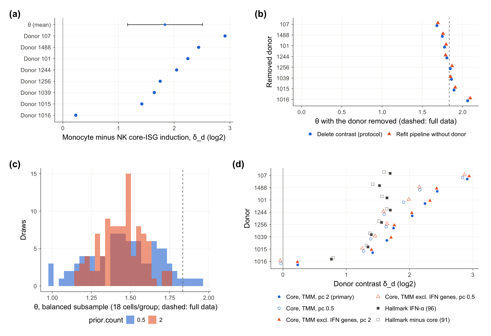

### Analytical sensitivity and context dependence of monocyte–NK interferon-β induction contrasts

#### Overview

We examined how analytical choices affected the direction, magnitude and donor-level agreement of a monocyte–natural killer (NK) cell induction contrast. Our primary analysis used paired untreated and interferon-β (IFN-β)-stimulated peripheral blood mononuclear cells from eight donors with systemic lupus erythematosus (SLE; GSE96583). We quantified induction of a published ten-gene panel using donor-level pseudobulk profiles and assessed transferability across experimental settings.

At 6 h, we estimated mean induction to be 1.834 $\log_2$ units greater in $\mathrm{CD14}^{+}$ monocytes than in NK cells (95% donor-level $t$-interval, 1.163–2.506). We retained a positive mean across the evaluated specifications and found that its magnitude and donor-level sign agreement depended on low-count regularization and cell sampling. In a separate five-donor cohort with enriched cell populations and 21 h exposure, we observed greater induction in NK cells. Our analysis of a three-donor PBMC time course yielded an increase in the contrast between 4 and 24 h. We classified the hypothesized decrease as unsupported.

We documented stability of the average direction within the primary dataset and limited transferability across experimental contexts. A general ranking of cellular IFN responsiveness and the causes of the between-cohort differences remained unresolved.

#### Scientific background and research question

[Kang et al. (2018)](https://doi.org/10.1038/nbt.4042) demonstrated cell-type-specific transcriptional responses to IFN-β in the dataset we reanalysed. [Rigby et al. (2026)](https://doi.org/10.1038/s44319-026-00750-3) subsequently identified a ten-gene panel induced across the evaluated PBMC types and five type I IFNs in an independent single-donor experiment. We used this shared inducible panel as a defined measurement target. The stability of the ordering of cell-type induction across analytical specifications and experimental settings required separate evaluation.

Prior methodological work motivated our evaluation of the expression scale. TMM normalization addressed RNA-composition differences through effective library sizes ([Robinson & Oshlack, 2010](https://doi.org/10.1186/gb-2010-11-3-r25)), and transformation benchmarks demonstrated dependence of performance on the downstream task ([Ahlmann-Eltze & Huber, 2023](https://doi.org/10.1038/s41592-023-01814-1)). We therefore evaluated the sensitivity of our specified induction contrast directly.

We asked whether a monocyte-minus-NK contrast retained its average direction, magnitude and individual donor signs when we changed the measurement specification. We then assessed transferability across designs using external datasets.

#### Study design and methodology

##### Datasets and analytical units

| Analysis                                                                          | Donors and preparation                                                       | IFN-β exposure                                       |
|-----------------------------------------------------------------------------------|------------------------------------------------------------------------------|------------------------------------------------------|
| [GSE96583](https://www.ncbi.nlm.nih.gov/geo/query/acc.cgi?acc=GSE96583)           | Eight SLE donors; mixed PBMCs, pooled by condition                           | 100 U/mL, 6 h                                        |
| [HIRISA, GSE306664](https://www.ncbi.nlm.nih.gov/geo/query/acc.cgi?acc=GSE306664) | Five healthy donors; monocytes and NK cells enriched and cultured separately | 100 U/mL, 21 h                                       |
| [GSE226572](https://www.ncbi.nlm.nih.gov/geo/query/acc.cgi?acc=GSE226572)         | Three healthy male donors; mixed PBMCs                                       | 1,000 U/mL, 1–36 h; total culture time fixed at 36 h |

We obtained the primary input from `muscData::Kang18_8vs8()` (ExperimentHub EH2259). We retained singlets annotated as $\mathrm{CD14}^{+}$ monocytes or NK cells with at least 200 detected genes, yielding 7,346 cells in 32 donor × cell-type × condition groups; the smallest group contained 18 cells. We summed counts within each group and used donors as the replication units, following the distinction between sample-level inference and cell-level observations discussed by [Crowell et al. (2020)](https://doi.org/10.1038/s41467-020-19894-4) and [Squair et al. (2021)](https://doi.org/10.1038/s41467-021-25960-2).

##### Measurement and estimands

We retained the published panel unchanged: IFI44L, ISG15, IFIT3, XAF1, MX1, IFI6, IFIT1, TRIM22, MX2 and RSAD2. We estimated TMM factors separately within each cell type using edgeR, applied expression filtering only to factor estimation, and scored all panel genes. Our primary transformation used edgeR $\log_2$ counts per million (CPM), with prior count $p=2$.

For donor $d$, panel gene $g$ and cell type $\ell$, we denoted transformed expression in the stimulated and control profiles by $y_{dg\ell}^{\mathrm{stim}}$ and $y_{dg\ell}^{\mathrm{ctrl}}$. We defined induction $R_{d\ell}$ as the mean stimulated-minus-control difference across the ten genes. We calculated the donor contrast $\delta_d$ by subtracting NK induction from monocyte induction and averaged the contrasts across $n$ donors to obtain $\theta$ ($n=8$ in the primary analysis):

$$
R_{d\ell}=\frac{1}{10}\sum_{g=1}^{10}(y_{dg\ell}^{\mathrm{stim}}-y_{dg\ell}^{\mathrm{ctrl}}),\qquad
\delta_d=R_{d,\mathrm{mono}}-R_{d,\mathrm{NK}},\qquad
\theta=\frac{1}{n}\sum_{d=1}^{n}\delta_d.
$$

We weighted genes and donors equally and measured induction on a normalized relative transcript scale. We calculated 95% $t$-intervals under the assumption of independent, approximately normal donor contrasts, conditional on the fitted normalization and selected specification. Uncertainty from shared normalization-factor estimation and analytical choice remained unquantified by these intervals.

We examined sensitivity to prior count 0.5, donor exclusion, 100 subsamples of 18 cells per group, removal of high-UMI cells, expression-matched non-IFN reference panels, and TMM estimation excluding IFN-linked genes. We removed high-UMI cells above the 99.5th percentile within cell-type × condition strata, pooled across donors. Under a later [fixed-offset specification](analysis/inputs/fixed_offset_specification.tsv), we evaluated $\log_2(\mathrm{CPM}+1)$ using the same counts and TMM factors.

Our original Hallmark IFN-α analysis failed its identifier-coverage threshold (86/97 genes, below 90%). After inspecting the original results, we repaired the identifiers and performed 96-gene and 91-gene analyses. In a separate, later [gene-set specification](analysis/hallmark_gene_set/specification.tsv), we fixed 93 genes measurable in all three cohorts and an 88-gene set excluding the five shared panel genes. We treated each gene set as a distinct measurement with its own estimand.

We used HIRISA for a [transferability analysis](analysis/independent_cohort/specification.tsv) across experimental contexts. We locked decisions for the [time-course analysis](analysis/time_course/specification.tsv) before computing its original outcomes. We hypothesized a decrease in the contrast, measured by $\Gamma=\frac{1}{3}\sum_{d=1}^{3}[\delta_d(24\,\mathrm{h})-\delta_d(4\,\mathrm{h})]$. We reused these three donors in later annotation checks. We found no documentation of prospective preregistration of the primary study in the repository.

#### Principal findings

##### We retained a positive primary mean across analytical specifications

We observed induction of all ten panel genes in both cell types in all eight donors. Every primary donor contrast was positive, with mean $\hat{\theta}=1.834$. We summarized selected sensitivity estimates below:

| Ten-gene measurement in GSE96583                                | Mean contrast | 95% donor-level $t$-interval | Positive donor contrasts |
|-----------------------------------------------------------------|--------------:|-----------------------------:|-------------------------:|
| Prior count 2, primary                                          |         1.834 |                  1.163–2.506 |                      8/8 |
| Prior count 0.5                                                 |         1.595 |                  0.905–2.284 |                      7/8 |
| TMM factors estimated excluding IFN-linked genes, prior count 2 |         1.853 |                  1.171–2.534 |                      8/8 |
| Fixed offset, $\log_2(\mathrm{CPM}+1)$                          |         1.233 |                  0.692–1.773 |                      7/8 |

We reported all values in $\log_2$ units and recorded the full results in the [primary estimates](results/primary_contrast/02_primary_estimate/primary.csv), [alternative normalization](results/primary_contrast/10_normalization_diagnostics/alt_norm_summary.csv) and [fixed-offset results](results/primary_contrast/14_fixed_offset_measurement/).

We obtained means of 1.680–2.063 after deleting each donor contrast and 1.694–2.095 after refitting the pipeline with each donor excluded. We retained a positive mean in every one of the 100 cell subsamples at both prior counts. We observed positive contrasts for all eight donors in 89/100 draws at prior count 2 and 54/100 at prior count 0.5. Subsample medians were 1.450 and 1.473, respectively. We used their empirical distributions to describe cell-sampling variation within the original donor set. In the all-cell comparisons, donor 1016's contrast changed from +0.232 to −0.034 at prior count 0.5 and −0.142 under the fixed offset.

We traced the regularization sensitivity to the additive offset on the CPM scale. For within-cell-type induction, we expressed edgeR's scaled prior as the equivalent offset $c_\ell=10^6p/\overline{E}_\ell$, where we used $p$ for the prior count and $\overline{E}_\ell$ for the mean TMM effective library size of cell type $\ell$. At prior count 2 this offset was 2.52 CPM in monocytes and 17.01 CPM in NK cells. The larger offset raised low control values more in the smaller NK libraries and attenuated estimated NK induction. We obtained a reduction of 0.601 in the mean contrast after replacing these offsets with 1 CPM. We interpreted this result as evidence of sensitivity to the expression scale; the optimal scale remained unresolved.



*Primary-cohort robustness.* We plotted (a) donor contrasts and the mean with its 95% interval; (b) donor deletion estimates from contrast deletion and pipeline refitting; (c) distributions of subsample means; and (d) donor contrasts under alternative specifications, including the identifier-repaired Hallmark sets. We plotted the fixed-offset comparison [separately](results/primary_contrast/figures/14_fixed_offset_donor_contrasts.png).

##### We observed negative ten-gene contrasts in HIRISA

In HIRISA, we obtained negative contrasts in all five donors: $\hat{\theta}=-4.609$ (descriptive 95% $t$-interval, −7.158 to −2.060). We observed high panel expression in untreated monocytes from four donors, coinciding with reduced induction. The cause of that baseline expression remained unresolved. We observed a change of +0.155 under the fixed offset. The depositors' MAST summaries also showed greater NK induction for all ten genes. We interpreted this agreement as analytical triangulation within the same cohort. We recorded the [cohort estimates](results/independent_cohort/h2_theta.csv) and [MAST comparison](results/independent_cohort/triangulation/core_gene_comparison.csv).

With the broader cross-cohort Hallmark set, we obtained a HIRISA mean of −0.990, an interval spanning zero (−2.354 to +0.374), and negative contrasts in four donors. After excluding shared panel genes, we obtained −0.758 (−2.035 to +0.518). We regarded the direction of the broader IFN-program contrast as uncertain given these intervals ([gene-set results](results/hallmark_gene_set/estimates.csv)).

##### We observed an increase in the time-course contrast

In GSE226572, we observed a rise in the mean contrast from −0.173 at 4 h to +0.382 at 24 h: $\Gamma=+0.555$, with an increase in every donor. We classified our hypothesized decrease as unsupported. We retained the observed direction across four annotation definitions ($\Gamma$, 0.553–0.597), including the depositors' labels. With three donors, the smallest attainable two-sided sign-flip $p$-value was 0.25; we treated these observations as descriptive. The original publication examined IFN-response dynamics ([de Cevins et al., 2023](https://doi.org/10.1016/j.xcrm.2023.101333)); we focused our reanalysis on the specified donor-level contrast.

We also obtained positive changes in every donor with the 93- and 88-gene Hallmark sets, with means of 0.322 and 0.312. The latter's $t$-interval included zero (−0.008 to +0.632). We therefore interpreted the broader-program temporal effect cautiously in view of its limited precision. We recorded the [time-course results](results/time_course/g3_summary.csv), [annotation checks](results/time_course/annotation_validation/gamma_by_annotation.csv) and [paired-contrast figure](results/time_course/figures/g3_fig3_paired_4h_24h.png).

#### Interpretation and limitations

We evaluated mean direction, effect magnitude and donor-level sign stability as separate properties of a defined transcriptional contrast. We retained a positive primary mean across the evaluated analytical changes and identified sensitivity in its magnitude and individual donor signs. Our external analyses established limits on transferring that direction to other settings. The experimental factors responsible for the differences remained unresolved. We interpreted each gene-set analysis according to its specific estimand.

We identified several constraints on interpretation:

- We analysed GSE96583 with donors pooled by condition in the original experiment. Stimulation remained confounded with processing pool after donor pairing. Our eight SLE donors at one dose and time point provided limited population coverage.
- We retained one primary group with 18 cells. We found zero counts in all 13 mitochondrial features, preventing informative mitochondrial filtering. We counted 24,679 singlets in the supplied annotation and noted the original article's reported count of 24,305; the discrepancy remained unresolved. We observed exposure-dependent changes in time-course monocyte markers and reused the same donors across annotation alternatives.
- We analysed cohorts that differed in health status, preparation, duration, dose and assay, and kept their donor contrasts separate. We found no documentation of the experimental role of the second untreated time-course library per donor. The individual contributions of disease, culture and duration remained unresolved.
- We measured induction on a normalized relative RNA scale. Absolute transcript abundance, receptor signalling, protein and cellular function remained unmeasured in our reanalysis. We observed high control expression alongside reduced induction; the biological cause remained unresolved.

From these results, we recommended reporting control expression, library sizes, the gene panel and regularization alongside donor-level contrasts. We identified an independent experiment with comparable preparation and exposure and replicated processing batches as the next test of transcriptional reproducibility. We also identified signalling or functional measurements as necessary to evaluate whether the contrast reflected a difference in cellular responsiveness.

#### Reproducibility

We recorded this terminology revision in the specification histories and preserved the original decision dates and completed outputs. We preserved archived run metadata and refreshed the release checksum manifest for the current repository files.

We reanalysed public experimental data using the accessions linked above. We recorded download URLs, sizes and checksums in each cohort's sample and download manifests.

We recorded MD5 `b890d4b6a805f6f7be00e89927d4b34e` for the primary cached input. We stored raw inputs and derived cell caches under Git-ignored `cache/` and excluded them from the release.

> [!WARNING]
> Use a separate working copy to preserve archived outputs. We implemented the primary pipeline to delete and recreate its output directory and the other analysis scripts to overwrite their outputs.

Install R 4.6.2 and the platform libraries required by the recorded packages, including HDF5. With `renv` installed, run from the repository root:

```bash
Rscript -e 'renv::restore(lockfile="release/renv.lock", prompt=FALSE); renv::activate()'
Rscript analysis/primary_contrast/tests/test_utils.R
Rscript analysis/primary_contrast/scripts/run_all.R
```

We recorded Bioconductor 3.23, edgeR 4.10.7 and the remaining package versions in the lockfile. Allow network access for restoration and uncached input retrieval, and activate the project library through the local `.Rprofile` created by `renv::activate()`. We configured the primary pipeline to load an existing `cache/Kang18_8vs8.Rda` and retrieve an uncached dataset through `muscData`. Use the frozen annotations and leave `00_fetch_annotation.R` unexecuted during reproduction.

Run the remaining components in dependency order:

```bash
### HIRISA
Rscript analysis/independent_cohort/scripts/00_download.R
Rscript analysis/independent_cohort/scripts/01_pilot.R
Rscript analysis/independent_cohort/scripts/02_analysis.R
Rscript analysis/independent_cohort/triangulation/01_triangulation.R

### Time course
Rscript analysis/time_course/scripts/00_manifest.R
Rscript analysis/time_course/scripts/01_download.R
Rscript analysis/time_course/scripts/02_annotation.R
Rscript analysis/time_course/tests/test_gse226572.R
Rscript analysis/time_course/scripts/03_analysis.R
Rscript analysis/time_course/annotation_validation/00_download_author_object.R
Rscript analysis/time_course/annotation_validation/01_extract_author_metadata.R
Rscript analysis/time_course/annotation_validation/02_map_author_labels.R
Rscript analysis/time_course/annotation_validation/test_rds_stream.R
Rscript analysis/time_course/annotation_validation/03_annotation_validation.R

### Fixed gene-set comparison and descriptive baseline synthesis
Rscript analysis/hallmark_gene_set/scripts/00_eligible_genes.R
Rscript analysis/hallmark_gene_set/scripts/01_hallmark.R
Rscript analysis/cross_study_synthesis/baseline_harmonization.R
```

Our HIRISA downloads totalled approximately 727 MB, and the analysis required about 5 GB RAM. Our time-course count files totalled about 1.2 GB; for annotation validation, we additionally downloaded a 10.4 GB Seurat object and extracted its metadata. We archived the original [session information](release/sessionInfo.txt), [software versions](release/software_versions.tsv), [run log](release/canonical_run.log) and [test log](release/canonical_tests.log) to document the environment and primary run.

To compare primary CSV tables with an archived run:

```bash
Rscript release/compare_runs.R /path/to/archived/results/primary_contrast results/primary_contrast /tmp/reproduction_comparison.csv
```

#### References and project citation

We included software and annotation resources in the full [BibTeX bibliography](references/references.bib). We used HIRISA data documented in the depositors' [preprint](https://doi.org/10.21203/rs.3.rs-8197575/v1).

For project attribution, cite the [repository](https://github.com/zeyuyaoy/interferon-response-robustness) with the commit used and cite the original data and methods papers relevant to the analysis.

We distributed our code under the [MIT license](LICENSE). Consult the source datasets' original terms for data reuse.
