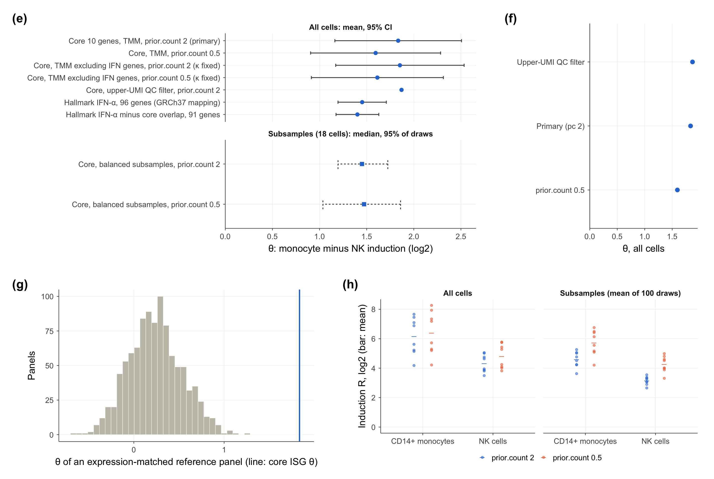
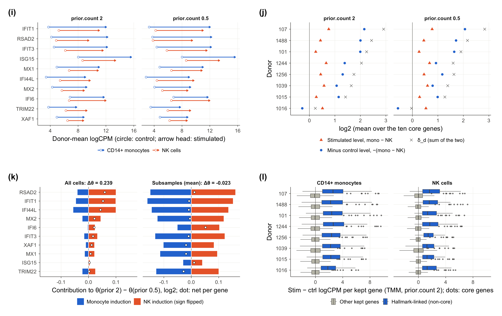

### Measurement Sensitivity of Interferon-Signature Induction Contrast in Human Monocytes and NK Cells

We examined a fixed ten-gene interferon panel in matched untreated and six-hour IFN-β-stimulated samples from eight SLE donors in GSE96583. Our donor-paired pseudobulk analysis distinguished the persistence of the average monocyte-NK induction direction from the sensitivity of its magnitude and individual donor signs to measurement choices.

#### Results

For donor $d$, lineage $\ell \in \lbrace \text{mono}, \text{NK} \rbrace$ and core gene $g$, induction was the mean stimulated-minus-control difference in TMM-normalized $\log_2$ CPM, and the estimand was the equally weighted donor mean of the paired lineage contrasts:

$$
R_{d\ell} = \frac{1}{10} \sum_{g=1}^{10} \left( y_{dg\ell}^{\text{stim}} - y_{dg\ell}^{\text{ctrl}} \right), \qquad
\delta_d = R_{d,\text{mono}} - R_{d,\text{NK}}, \qquad
\theta = \frac{1}{8} \sum_{d=1}^{8} \delta_d .
$$

From 7,346 CD14⁺ monocytes and NK cells, the primary estimate was $\hat{\theta} = 1.834$ (conditional 95% $t$-interval $[1.163, 2.506]$; exact one-sided sign-flip $p = 2^{-8} \approx 0.0039$), with $\delta_d > 0$ in all eight donors ($0.232 \le \delta_d \le 2.912$). The direction persisted across every specification we examined, but the magnitude and individual donor signs did not:

| Specification                                   | $\hat{\theta}$ | Interval           | Donors with $\delta_d > 0$ |
|-------------------------------------------------|----------------|--------------------|----------------------------|
| Core 10 genes, TMM, prior 2 (primary)           | 1.834          | $[1.163, 2.506]$   | 8/8                        |
| Core, prior 0.5                                 | 1.595          | $[0.905, 2.284]$   | 7/8                        |
| Hallmark IFN-α, 96 genes †                      | 1.452          | $[1.196, 1.709]$   | 8/8                        |
| Balanced subsamples (18 cells/group), prior 2   | 1.450 ‡        | $[1.196, 1.724]$ ‡ | 8/8 in 89 of 100 draws     |
| Balanced subsamples (18 cells/group), prior 0.5 | 1.473 ‡        | $[1.036, 1.859]$ ‡ | 8/8 in 54 of 100 draws     |

All values are in $\log_2$ units. † Post hoc. ‡ Median and 2.5th-97.5th percentiles over 100 cell draws. All other intervals are conditional donor-level 95% $t$-intervals with 7 degrees of freedom.

> [!NOTE]
> Donor 1016 drove the sign sensitivity—$\delta_{1016}$ moved from 0.232 to $-0.034$ when we lowered the prior count from 2 to 0.5.

Core genes were sparse in untreated controls, and the same nominal prior added 2.52 CPM in monocytes but 17.01 CPM in NK cells, because $`\kappa = \text{prior} / \bar{L}_\ell`$ depended on each lineage's mean effective library size $`\bar{L}_\ell`$. This arithmetic effect of the score definition helps explain why the magnitude depended on the prior.

#### Figures

**Donor robustness.** (a) $\delta_d$ and $\hat{\theta}$ with its 95% interval; (c) balanced subsampling; (d) $\delta_d$ across specifications.


**Specification sensitivity.** (e) $\hat{\theta}$ across specifications; (f) prior sensitivity; (h) lineage induction $R_{d\ell}$ at both priors.



**Expression and normalization.** (i) Control and stimulated expression per gene; (j) stimulated- and control-level decomposition of each $\delta_d$.



#### Reproducibility

The recorded and checked environment used R 4.6.2 with Bioconductor 3.23 (`muscData`, `ExperimentHub`, `SingleCellExperiment`, `edgeR`) and CRAN `Matrix`, `ggplot2`, `msigdbr`, `httr2` (annotation fetch only).

```bash
Rscript analysis/tests/test_utils.R
Rscript analysis/00_fetch_annotation.R
Rscript analysis/run_all.R
```

We ran these from the repository root. `00_fetch_annotation.R` was a one-time download into `analysis/inputs/annotation/`. 

The saved specification was `analysis/config.R` plus the files in `analysis/inputs/` (see `analysis/inputs/manifest.txt`).

> [!IMPORTANT]
> Each run clears `results/` and `figures/`, so we used a separate working copy to preserve existing outputs.

#### Layout

```
README.md
analysis/
  config.R, utils_*.R
  00_fetch_annotation.R
  01_quality_control.R ... 13_summary_figures.R
  run_all.R
  inputs/
  tests/test_utils.R
results/<step>/   (generated, not tracked)
figures/
```
