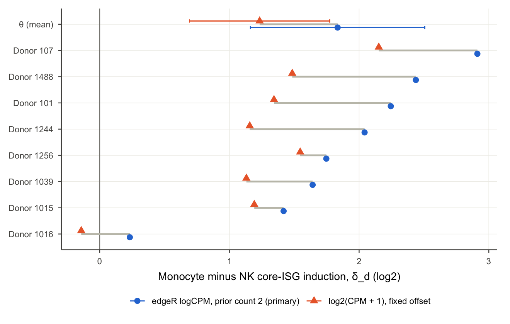

### Measurement Sensitivity of Interferon-Signature Induction Contrast in Human Monocytes and NK Cells

Interferon (IFN) responses are frequently compared between immune cell types by scoring a set of IFN-stimulated genes in each population. Induction of a gene set in every cell type does not, however, establish that the resulting scores are quantitatively comparable between cell types; each score also depends on normalization and log transformation, and these procedures can act differently on populations that differ in sequencing depth.

We examined the extent to which one such comparison depends on analytical choices. We analysed single-cell RNA-sequencing data from peripheral blood cells of eight donors with systemic lupus erythematosus (SLE). Matched aliquots from each donor were either left untreated or stimulated with IFN-β for 6 h (GEO GSE96583). Counts from CD14$`^+`$ monocytes and natural killer (NK) cells were aggregated by donor, cell type and condition into pseudobulk profiles, and the induction of a published ten-gene IFN panel was quantified. 

We found that mean induction was 1.834 $`\log_2`$ units greater in monocytes than in NK cells, and greater in monocytes in every donor. The direction of this difference was preserved in every alternative analysis; its magnitude ranged from 1.23 to 1.87, however, and the sign for one donor reversed. The most influential choices were how low counts were regularized before log transformation (the prior count, or a fixed offset in counts per million) and the number of cells aggregated per pseudobulk. In an independent cohort of five healthy donors whose monocytes and NK cells were enriched and cultured separately for 21 h (HIRISA, GEO GSE306664), the contrast was reversed, because untreated monocytes were already IFN-activated in four of the five donors; the regularization of low counts changed the contrast by only 0.155, because pseudobulk libraries were 94-378 times larger.

Cell-type-specific IFN responses in this dataset were reported previously ([Kang et al., 2018](https://doi.org/10.1038/nbt.4042)); our study further evaluated three properties of the comparison:

1) its average direction,
2) its magnitude, and
3) its consistency across individual donors.

#### Study design

We used `muscData::Kang18_8vs8()` (ExperimentHub EH2259; GSE96583), comprising 35,635 genes and 29,065 droplets. Cells from each of eight SLE donors were cultured for 6 h with or without 100 U/mL IFN-β. Cells from all donors were then pooled by condition and sequenced ([Kang et al., 2018](https://doi.org/10.1038/nbt.4042)). "Control" denotes the untreated aliquot cultured in parallel with the stimulated aliquot.

We retained cells annotated as singlets and as CD14$`^+`$ monocytes or NK cells, with at least 200 detected genes. The final dataset comprised 7,346 cells in 32 groups (8 donors × 2 cell types × 2 conditions). The smallest group, the control NK cells of donor 1039, contained 18 cells.

Counts were summed within each group to generate 32 pseudobulk profiles. Monocyte and NK profiles were normalized separately using the trimmed mean of M-values (TMM) method in edgeR, which adjusts for differences in library size and composition between samples ([Robinson & Oshlack, 2010](https://doi.org/10.1186/gb-2010-11-3-r25); [Chen et al., 2025](https://doi.org/10.1093/nar/gkaf018)). Lowly expressed genes were excluded only during estimation of the normalization factors; all genes were retained for scoring. Expression was expressed as $`\log_2`$ counts per million (CPM), with a prior count $`p`$ added before transformation to avoid undefined values for zero counts ($`p = 2`$ in the primary analysis).

The panel comprised IFI44L, ISG15, IFIT3, XAF1, MX1, IFI6, IFIT1, TRIM22, MX2 and RSAD2. These genes were defined in an independent study by their consistent induction across type I IFNs and cell types ([Rigby et al., 2026](https://doi.org/10.1038/s44319-026-00750-3)). No gene was selected or excluded on the basis of the present data.

All analyses are specified in `analysis/config.R` and the files in `analysis/inputs/`:
- a lower prior count (0.5);
- sequential exclusion of each donor;
- 100 random subsamples of 18 cells per group, equalizing cell numbers across groups;
- exclusion of cells above the 99.5th percentile of UMI counts within each group, as a safeguard against doublets;
- comparison with random, expression-matched panels of non-IFN genes;
- estimation of TMM factors without IFN-related genes;
- a revised identifier mapping of the Hallmark IFN-α gene set;
- the Hallmark set excluding the genes shared with the panel;
- ordering of donors by baseline expression;
- an alternative expression measurement, $`\log_2(\mathrm{CPM}+1)`$ with a fixed offset of 1 CPM (`fixed_offset_cpm`; `analysis/inputs/fixed_offset_specification.tsv`).

#### Results

For donor $`d`$ and cell type $`\ell`$ (monocyte or NK), **induction** $`R_{d\ell}`$ was defined as the mean difference between stimulated and control $`\log_2`$ CPM across the ten panel genes. The **contrast** $`\delta_d`$ is the difference between monocyte and NK induction within a donor; $`\theta`$ is the mean contrast across the eight donors:

$$
R_{d\ell} = \frac{1}{10} \sum_{g=1}^{10} \left( y_{dg\ell}^{\text{stim}} - y_{dg\ell}^{\text{ctrl}} \right), \qquad
\delta_d = R_{d,\text{mono}} - R_{d,\text{NK}}, \qquad
\theta = \frac{1}{8} \sum_{d=1}^{8} \delta_d .
$$

Here, $`y_{jg} = \log_2\!\left[10^6 (C_{jg} + p_j)/(E_j + 2p_j)\right]`$, where $`C_{jg}`$ is the count for gene $`g`$ in pseudobulk $`j`$. $`E_j`$ is the **effective library size**, defined as the total count multiplied by the TMM factor. $`p_j = p\,E_j/\bar{E}_\ell`$ scales the prior count by relative library size, as implemented in edgeR. Each gene contributes equally to $`R`$; each donor contributes equally to $`\theta`$, irrespective of cell number. A value of $`\theta = 1.834`$ therefore denotes a mean difference in induction of 1.834 $`\log_2`$ units on this normalized relative scale.

> [!NOTE]
> $`\theta`$ does not represent a difference in absolute transcript abundance or in signalling activity.

| Analysis                                                  | $`\hat{\theta}`$  | Interval                       | Donors with $`\delta_d > 0`$ |
|-----------------------------------------------------------|-------------------|--------------------------------|------------------------------|
| Ten-gene panel, prior count 2 (primary)                   | 1.834             | $`[1.163, 2.506]`$             | 8/8                          |
| Ten-gene panel, prior count 0.5                           | 1.595             | $`[0.905, 2.284]`$             | 7/8                          |
| Ten-gene panel, TMM factors estimated without IFN genes   | 1.853             | $`[1.171, 2.534]`$             | 8/8                          |
| Ten-gene panel, top 0.5% UMI cells per group removed (38) | 1.870             | -                              | -                            |
| Ten-gene panel, $`\log_2(\mathrm{CPM}+1)`$, fixed offset  | 1.233             | $`[0.692, 1.773]`$             | 7/8                          |
| Hallmark IFN-α set, 96 genes                              | 1.452             | $`[1.196, 1.709]`$             | 8/8                          |
| Hallmark IFN-α set excluding 5 panel genes, 91 genes      | 1.402             | $`[1.175, 1.629]`$             | 8/8                          |
| Subsamples of 18 cells per group, prior count 2           | 1.450<sup>‡</sup> | $`[1.196, 1.724]`$<sup>‡</sup> | 8/8 in 89 of 100 draws       |
| Subsamples of 18 cells per group, prior count 0.5         | 1.473<sup>‡</sup> | $`[1.036, 1.859]`$<sup>‡</sup> | 8/8 in 54 of 100 draws       |

Values are in $`\log_2`$ units. Unless otherwise indicated, intervals are 95% $`t`$-intervals across the eight donor contrasts (7 degrees of freedom). 

<sup>‡ Median and 2.5th-97.5th percentiles across 100 random cell subsamples; hallmark analyses score a larger and different gene set, and their values are therefore not directly comparable with those of the ten-gene panel.</sup>

##### Monocytes exhibited greater induction than NK cells in all eight donors

All ten genes were induced in both cell types in every donor (monocyte $`R`$, 4.18-7.66; NK $`R`$, 3.50-5.05), consistent with the original definition of the panel ([Rigby et al., 2026](https://doi.org/10.1038/s44319-026-00750-3)). Induction was greater in monocytes in every donor. Donor contrasts ranged from 0.232 (donor 1016) to 2.912 (donor 107), with a mean of $`\hat\theta = 1.834`$ (SD, 0.804; 95% $`t`$-interval, 1.163-2.506).

The interval assumes that the eight donor contrasts are independent and approximately normally distributed; it does not incorporate uncertainty arising from the joint estimation of normalization factors or from the choice among alternative analytical specifications; it is therefore described as conditional. An exact one-sided sign-flip test, which compares the observed mean with the means obtained under all $`2^8`$ sign assignments of the eight contrasts, yielded $`p = 2^{-8} \approx 0.0039`$. This is the minimum attainable value with eight donors; it arises whenever all contrasts are positive. Donors were treated as the units of replication, because cells from the same donor are not statistically independent ([Squair et al., 2021](https://doi.org/10.1038/s41467-021-25960-2); [Zimmerman et al., 2021](https://doi.org/10.1038/s41467-021-21038-1)).

Studies of purified human blood cells have shown that both IFN-induced transcriptional programs ([Waddell et al., 2010](https://doi.org/10.1371/journal.pone.0009753)) and proximal type I IFN signalling ([van Boxel-Dezaire et al., 2006](https://doi.org/10.1016/j.immuni.2006.08.014)) differ between cell types. Such differences may account for the observed contrast; transcriptomic data alone, however, cannot establish which mechanism is responsible.

##### No single donor determined the mean contrast

To assess the influence of individual donors, each donor was excluded in turn. Exclusion of a single donor's contrast yielded means of 1.680-2.063. Re-running the complete pipeline, including normalization, without that donor yielded 1.694-2.095. The largest change upon exclusion of a contrast was 0.229, below the threshold of 0.25 specified in the analysis plan for identifying an influential donor. Donor 1016 exerted the greatest influence: its exclusion *increased* the mean to 2.063 (2.095 after re-running), because its contrast was the smallest. As all eight contrasts were positive, exclusion of a single donor could not reverse the sign of the mean. This analysis therefore assesses the stability of the magnitude.

##### The prior count altered the magnitude of the contrast and the sign for one donor

The prior count is a constant added to all counts before log transformation. Reducing it from 2 to 0.5 decreased $`\hat\theta`$ to 1.595 (0.905-2.284) and changed the contrast for donor 1016 from 0.232 to −0.034. Induction *increased* in both cell types (monocytes, 6.158 to 6.394; NK cells, 4.323 to 4.799). The contrast decreased because the increase was larger in NK cells.

This asymmetry arises because edgeR scales the prior count by library size. NK pseudobulks contained substantially fewer counts than monocyte pseudobulks (mean effective library size, 117,580 versus 793,081), principally because NK groups comprised fewer cells. A prior count of 2 consequently added 17.01 CPM to each NK gene and 2.52 CPM to each monocyte gene. A larger additive constant raises near-zero control values disproportionately and thereby reduces the estimated induction. In NK cells, this effect was most pronounced for genes with minimal expression before stimulation. Three such genes, RSAD2, IFIT1 and IFI44L, were detected in 1.2-4.5% of control cells; they accounted for 0.156 of the 0.239 reduction in $`\hat\theta`$ (65.1%). The sensitivity of log-transformed single-cell data to the prior count is well documented ([Ahlmann-Eltze & Huber, 2023](https://doi.org/10.1038/s41592-023-01814-1)). In the present data, an identical setting acted unequally on two cell types that differed in library size.

##### A fixed offset of 1 CPM reduced the magnitude of the contrast and again reversed the sign for donor 1016

To test whether the sensitivity of the contrast is associated with the library-size-dependent regularization in edgeR log-CPM, we replaced $`\log_2`$ CPM with $`\log_2(\mathrm{CPM}+1)`$, which adds a fixed offset of 1 CPM to every pseudobulk profile. The primary TMM effective library sizes, pseudobulk profiles, genes and donors were reused without refitting. Because the edgeR denominator term cancels in stimulated-minus-control differences, the two measurements differ only in the CPM added to each value: 2.52 (monocytes) and 17.01 (NK cells) in the primary analysis, and 1 in both cell types here.

With the fixed offset, $`\hat\theta`$ was 1.233 (0.692-1.773), 0.601 lower than in the primary analysis. The contrast decreased in every donor, by 0.202-0.953 (mean paired difference, −0.601; 95% $`t`$-interval, −0.862 to −0.341). NK induction increased by 0.778 and monocyte induction by 0.176. Seven donor contrasts remained positive (1.131-2.152), whereas that of donor 1016 changed from 0.232 to −0.142, as it had at prior count 0.5. RSAD2, IFIT1 and IFI44L accounted for 0.442 of the 0.601 reduction (73.5%), almost entirely through greater NK induction; these are the same sparsely detected control NK genes that accounted for the effect of the prior count. Under the criteria in `analysis/inputs/fixed_offset_specification.tsv`, the result shows sensitivity of magnitude (change ≥ 0.25) and a donor-level change of direction confined to donor 1016; the positive mean was unchanged.

These results indicate that approximately one third of the primary magnitude depends on the larger CPM offset that edgeR applies to the smaller NK libraries. They do not identify a correct value. An equal offset on the CPM scale corresponds to unequal regularization on the count scale (approximately 0.79 counts per monocyte and 0.12 per NK pseudobulk at the mean library size); the fixed-offset estimate therefore redistributes, rather than removes, the dependence on library size.

##### Equalizing cell numbers preserved the direction of the contrast and reduced its magnitude

Because monocyte groups contained more cells than NK groups, 18 cells (the size of the smallest group) were drawn from every group, and the analysis was repeated across 100 draws. Identical cells were used at both prior counts. The mean contrast was positive in all 100 draws at both prior counts, with medians of 1.450 (prior count 2) and 1.473 (prior count 0.5). All eight donor contrasts were simultaneously positive in 89 draws at prior count 2 and in 54 draws at prior count 0.5. The contrast for donor 1016 was positive in 90 and 59 draws, respectively, whereas that of every other donor was positive in at least 95.

Subsampling reduced the estimate: the full-data value (1.834) exceeded the 97.5th percentile of the prior-count-2 draws (1.724), and induction was lower in both cell types (monocytes, 4.59; NK cells, 3.15). In subsamples, reducing the prior count had little effect (change in $`\hat\theta`$, −0.023, compared with 0.239 using all cells). Subsampling simultaneously alters the cells included, library sizes, the genes that pass filtering, the TMM factors and the CPM added by the prior count. The present analysis cannot attribute the reduction to any one of these factors. Neither the full-data nor the subsampled estimate is more valid, as each is conditional on the number of cells aggregated.

> [!NOTE]
> All draws derive from the same donors and sequenced cells; they therefore quantify sensitivity to cell selection and do not constitute independent biological replicates.

##### Between-donor variation reflected differences in control monocyte expression

To identify the source of between-donor variation, panel expression in control and stimulated monocytes was compared across donors. All monocyte profiles were normalized jointly, so these values are directly comparable between donors. Stimulated monocyte expression was similar across donors (10.74-11.24 $`\log_2`$ CPM), whereas control expression ranged more widely, from 3.58 to 6.66. The ranking of donors by control monocyte expression was the exact inverse of their ranking by contrast (Spearman ρ = −1). This relationship is largely a consequence of the definition: when stimulated levels are nearly constant, higher control expression necessarily corresponds to lower induction. The correlation therefore identifies the source of between-donor variation and is descriptive.

Donor 1016 had the highest control monocyte expression (6.66), the lowest monocyte induction (4.18) and the smallest contrast. It was also the only donor in which control monocytes expressed the panel at a higher level than control NK cells (+0.28). Peripheral blood cells from many patients with SLE express IFN-inducible genes at elevated levels as a result of ongoing IFN exposure in vivo ([Baechler et al., 2003](https://doi.org/10.1073/pnas.0337679100); [Bennett et al., 2003](https://doi.org/10.1084/jem.20021553)). Cells with such elevated baseline expression have less capacity for further induction in culture, which may account for the profile of donor 1016. Evaluation of this explanation would require clinical, serum IFN or treatment data, which are not available for this dataset.

An analogous decomposition can be expressed across cell types. Averaged across donors, monocyte expression exceeded NK expression by 0.487 $`\log_2`$ units after stimulation and was 1.347 units lower in controls, giving 0.487 − (−1.347) = 1.834. This partition does not have a biological interpretation; because the two cell types were normalized separately, a constant shift in all monocyte values would alter both terms equally without changing $`\theta`$.

Individual genes differed in induction amplitude. Nine of the ten genes were induced more strongly in monocytes, with the largest differences for RSAD2 (+3.41), ISG15 (+2.91) and IFIT1 (+2.50). IFI6 was induced more strongly in NK cells (−0.37). IFI6 also exhibited the largest difference in control detection between cell types: it was detected in 23% of control monocytes and 9% of control NK cells. This observation parallels the donor-level pattern, in which higher control expression accompanied lower induction; a result obtained at the panel level should therefore not be attributed to each constituent gene.

##### A larger IFN-α gene set reproduced the direction of the contrast with reduced between-donor variability

To determine whether the result depended on the choice of ten genes, the analysis was repeated with the Hallmark IFN-α response gene set ([Liberzon et al., 2015](https://doi.org/10.1016/j.cels.2015.12.004)). The version specified in the analysis plan could not be evaluated: only 86 of the 97 gene symbols (88.7%) mapped uniquely to the dataset, below the specified minimum of 90%. In a revised analysis, symbols were mapped through HGNC and Ensembl identifiers from GRCh37, the genome build of the dataset ([Seal et al., 2023](https://doi.org/10.1093/nar/gkac888); [Yates et al., 2015](https://doi.org/10.1093/bioinformatics/btu613)). This procedure resolved 96 genes and yielded $`\hat\theta = 1.452`$ (1.196-1.709; SD, 0.307). Five of these genes are also members of the ten-gene panel; their exclusion left 91 genes and yielded 1.402 (1.175-1.629; SD, 0.271), with a minimum donor contrast of 0.790. All donor contrasts were positive in both analyses.

Between-donor standard deviation was 62-66% lower than for the ten-gene panel (0.804); the contrast for donor 1016 increased from 0.23 to 0.76. Averaging across a larger number of genes is likely to reduce the influence of a small number of sparsely detected genes. Because the 91-gene analysis excludes all panel genes, the greater induction in monocytes is not restricted to those ten genes. These analyses nevertheless derive from the same donors and experiment and do not constitute independent replication. 

> [!CAUTION]
> Scores derived from gene sets that differ in size and composition are not on a common scale ([Andreatta & Carmona, 2021](https://doi.org/10.1016/j.csbj.2021.06.043); [Ciernik et al., 2026](https://doi.org/10.1101/gr.280926.125)), so the values 1.45 and 1.83 should not be interpreted as estimates of a single quantity.

##### The panel contrast exceeded that of all expression-matched random panels

Genes with low control expression may exhibit large apparent induction for technical reasons. To assess this possibility, the panel was compared with random non-IFN genes of similar control expression, an approach established in single-cell gene-set scoring ([Tirosh et al., 2016](https://doi.org/10.1126/science.aad0501)). For each panel gene, a substitute was drawn from the 50 non-IFN genes nearest in control expression in both cell types. This procedure was repeated to generate 1,000 random ten-gene panels. The contrasts of these panels had a median of 0.233 (2.5th-97.5th percentiles, −0.312 to 0.837), and the IFN panel contrast of 1.834 exceeded all of them.

Two considerations limit this comparison. First, the median of the random panels exceeded zero, indicating that genes outside the IFN sets also showed a small monocyte-greater difference on this scale. Second, close matches were unavailable for the three most sparsely detected panel genes (RSAD2, IFI44L and IFIT1): 85-91% of their substitutes differed by more than 1 $`\log_2`$ unit. In addition, the sampling procedure does not select uniformly among all possible matched panels. The comparison is therefore reported as a descriptive rank.

##### Estimating TMM factors without IFN-related genes changed the contrast by approximately 0.02

TMM normalization assumes that most genes are not differentially expressed between samples. Stimulation violated this assumption for a subset of genes; IFN-related genes (the panel and the Hallmark IFN-α and IFN-γ genes) accounted for 23-27% of counts in stimulated monocyte pseudobulks, compared with 6-7.5% in controls. The corresponding proportions in NK pseudobulks were 16-19% and 8.5-10%; monocyte TMM factors shifted accordingly, from 1.11-1.24 in controls to 0.80-0.96 after stimulation. TMM is designed to accommodate such shifts by trimming genes with extreme fold changes ([Robinson & Oshlack, 2010](https://doi.org/10.1186/gb-2010-11-3-r25)).

To verify that this occurred, TMM factors were re-estimated without IFN-related genes. The prior count was adjusted to add the same CPM as in the primary analysis, so that the comparison isolated the effect of the normalization factors. $`\hat\theta`$ changed by 0.018 at prior count 2 and by 0.019 at prior count 0.5. Median induction of non-IFN genes remained between −0.10 and 0.02 in every donor and cell type, consistent with the null change expected for unaffected genes. IFN-related genes therefore did not materially distort normalization. Exclusion of cells above the 99.5th percentile of UMI counts within each group (38 cells) yielded $`\hat\theta = 1.870`$.

##### In an independent cohort the contrast was reversed, and the regularization of low counts had little effect

To assess whether the direction of the contrast and its sensitivity to low-count regularization transfer beyond GSE96583, the same panel, estimand and transformations were applied to the Human IFN Response in Immune Subsets Atlas (HIRISA; GEO GSE306664; [Kuan et al., 2025](https://doi.org/10.21203/rs.3.rs-8197575/v1)). CD14$`^+`$ monocytes and NK cells were enriched separately from cryopreserved PBMC of five healthy donors, cultured for 21 h with or without 100 U/mL IFN-β, and profiled by 10x Genomics Flex. Control and stimulated samples of each donor and cell type were multiplexed into a single processing pool, so that, unlike in GSE96583, stimulation was not confounded with pool. The analysis was specified in `hirisa/specification.tsv`, which was locked after a one-donor pilot and before stimulated or NK data of the remaining four donors were downloaded. Cells labelled by the depositors as CD14 monocytes or NK cells with at least 200 detected genes were retained (217,231 cells in 20 groups; smallest group, the control monocytes of donor 3283BW, 977 cells). Each cell type was normalized separately by TMM across the ten profiles.

| Quantity                                                        | GSE96583 (8 SLE donors) | HIRISA (5 healthy donors)   |
|-----------------------------------------------------------------|-------------------------|-----------------------------|
| Stimulation; preparation                                        | 6 h; PBMC               | 21 h; enriched cell types   |
| $`\hat\theta`$, prior count 2                                   | 1.834 (1.163, 2.506)    | −4.609 (−7.158, −2.060)     |
| $`\hat\theta`$, prior count 0.5                                 | 1.595                   | −4.616                      |
| $`\hat\theta`$, $`\log_2(\mathrm{CPM}+1)`$                      | 1.233                   | −4.454                      |
| $`D = \hat\theta_{\text{prior }2} - \hat\theta_{\text{CPM}+1}`$ | 0.601 (0.341, 0.862)    | −0.155 (−0.239, −0.070)     |
| Donors with $`\delta_d > 0`$ at prior count 2                   | 8/8                     | 0/5                         |
| Mean effective library size, monocytes / NK cells               | 793,081 / 117,580       | 74.9 million / 44.5 million |
| CPM added by prior count 2, monocytes / NK cells                | 2.52 / 17.01            | 0.027 / 0.045               |

<sup>Intervals are 95% $`t`$-intervals across donor contrasts (7 and 4 degrees of freedom); they are descriptive and conditional on the specification.</sup>

The contrast was negative in all five donors ($`\hat\theta = -4.609`$). NK induction (5.99-7.17) exceeded that in GSE96583 (3.50-5.05), whereas monocyte induction was small in four donors (0.16-1.90). In these four donors the panel was already highly expressed in untreated monocytes: mean control expression was 9.57-11.32 $`\log_2(\mathrm{CPM}+1)`$, compared with 5.80 in donor 3283BW, and ISG15 reached 1,409-11,406 CPM, compared with 109. Such levels exceed the range of control monocytes in GSE96583 (3.58-6.66). The rule specified to identify anomalous controls flagged no donor, because elevated control expression was the norm rather than the exception. In donor 3283BW, the only donor with low control expression, monocyte induction was 5.86 and the contrast −0.963. Elevated control expression after 21 h of culture of isolated monocytes, accompanied by CXCL10 and IFNB1 transcripts, is consistent with IFN production during culture; the present data cannot establish its cause.

On average, HIRISA pseudobulks contained 94 (monocytes) and 378 (NK cells) times more counts than those of GSE96583, and the prior count of 2 consequently added only 0.027 CPM to monocyte and 0.045 CPM to NK profiles. Reducing the prior count to 0.5 changed $`\hat\theta`$ by 0.007. Under $`\log_2(\mathrm{CPM}+1)`$, $`\hat\theta`$ was −4.454; the difference $`D = -0.155`$ (donor values −0.27 to −0.09) was below the threshold of 0.25, and no donor changed sign, which meets the prespecified criterion for agreement. $`D`$ is negative here because the fixed offset of 1 CPM now exceeds the offset applied by edgeR. As in GSE96583, its effect arose principally from NK genes that were sparsely detected in controls: IFIT1 and IFI44L (detected in 0.2-3.3% of control NK cells) accounted for 0.097 of the 0.155. In 100 subsamples of 977 cells per group, the median $`\hat\theta`$ was −4.571 (2.5th-97.5th percentiles, −4.663 to −4.474) and the median $`D`$ −0.081.

Thus, neither the direction nor the magnitude of the GSE96583 contrast was reproduced. Because the cohorts differ in donor health, stimulation duration, cell preparation and sequencing platform, the reversal cannot be attributed to any one of these differences, and HIRISA does not constitute a replication. The mechanism of the regularization effect did transfer: in both cohorts it acted through genes with sparse control expression, and it was small when both cell types had large libraries.

#### Conclusions

The results support four conclusions of differing strength.

1) In this cohort, monocytes exhibited greater mean induction than NK cells in every analysis, in every subsample and with both larger IFN gene sets. 
2) The magnitude of the contrast ranged from 1.23 to 1.87 in analyses using all cells and was approximately 1.45-1.47 in subsamples. It depended on the regularization of low counts (the prior count or a fixed CPM offset), the number of cells aggregated and the gene set. Any single estimate should therefore be reported together with these analytical choices. 
3) The contrast was positive in seven donors across all analyses. Its sign for donor 1016 depended on the regularization of low counts and on cell selection; this donor also had the highest control monocyte expression.
4) In an independent cohort of healthy donors whose monocytes and NK cells were cultured separately for 21 h, the contrast was reversed (−4.609), principally because untreated monocytes were already IFN-activated in four of five donors. The regularization of low counts changed this contrast by only 0.155, consistent with the much larger and more similar library sizes. The direction of the GSE96583 contrast should therefore not be generalized to other experimental designs.

> [!TIP]
> These findings suggest four reporting practices for studies that compare IFN scores between cell types:
>
> - Report the direction, the magnitude and the donor-level results separately.
> - Report the library size of each cell type, and the CPM added by the prior count or offset, with any log-CPM comparison, because an identical prior count acts differently on cell types with different library sizes, and an identical CPM offset corresponds to different numbers of counts.
> - Report control expression together with induction, because donors with elevated baseline IFN activity, as is common in SLE, exhibit reduced induction.
> - Treat scores from a larger gene set as a distinct measurement; such scores reduced between-donor variability in the present analysis but are on a different scale.

#### Limitations

In the original experiment, cells from all donors were pooled by condition, so that all control cells and all stimulated cells were each processed as a single pool. Effects of stimulation therefore cannot be fully separated from differences in the processing of the two pools. Neither donor pairing nor subsampling resolves this confounding.

Secondly, the analysis is restricted to a single cohort of eight SLE donors, one IFN-β dose and time point, and two broadly defined cell types. Clinical information was not available. The independent cohort examined (HIRISA) differs from GSE96583 in donor health, stimulation duration, cell preparation and platform, comprises five donors, and therefore assesses transferability rather than replication.

Furthermore, the control NK group of donor 1039 contained only 18 cells. All 13 mitochondrial genes have zero counts in the supplied matrix, which precluded filtering on mitochondrial content. The deposited annotation lists 24,679 singlets, whereas the original article reports 24,305; the source of this discrepancy could not be determined.

Finally, all results concern normalized transcript levels. Protein, signalling and functional measurements were not available.

A more definitive test would specify the gene set and all analytical parameters and apply them to an independent donor cohort, with control and stimulated cells distributed across multiple processing batches. HIRISA met the batch condition, but culture of isolated monocytes for 21 h altered their control state; a replication would also require mixed-cell culture and a stimulation duration comparable to that of GSE96583. A time course with matched signalling measurements would be required to establish whether the transcriptional difference reflects a difference in cellular responsiveness to IFN.

#### Figures

##### Donor-level robustness


**(a) Donor contrasts.** Each point represents the monocyte-minus-NK induction for one donor; the diamond and bar indicate the mean and its 95% interval. All eight contrasts exceed zero, which constitutes the principal result. Donor 1016 (0.23) is distinct from the remaining seven donors (1.42-2.91) and is the donor whose sign subsequently varies. **(b) Mean contrast after exclusion of each donor.** Circles denote exclusion of the donor contrast; triangles denote re-running of the complete pipeline without the donor. The mean remains between 1.68 and 2.10 (dashed line, all donors), indicating that no single donor determines the result. Agreement between the two procedures indicates that re-estimating normalization without a donor has little effect. **(c) Mean contrast across 100 subsamples of 18 cells per group.** All draws exceed zero at both prior counts. The full-data estimate (dashed line) lies at the upper extreme of the prior-count-2 distribution, indicating that the number of aggregated cells affects the magnitude of the estimate. The distribution at prior count 0.5 is wider. **(d) Donor contrasts across analyses.** The ordering of donors is broadly preserved across ten-gene analyses. Only donor 1016 falls below zero, and only at prior count 0.5 (−0.034; −0.043 with TMM factors estimated without IFN genes). The Hallmark gene sets (squares) reduce the dispersion between donors.

##### Sensitivity to analytical choices


**(e) Mean contrast across analyses.** All estimates and intervals exceed zero, with point estimates between 1.40 and 1.87; this panel summarizes the robustness of the direction. Solid bars denote 95% intervals across donors, and dashed bars denote the range across cell subsamples; these quantify different sources of variability. **(f) Quality control and prior count.** Exclusion of high-UMI cells has minimal effect on the mean (1.870), whereas reduction of the prior count produces the largest change. **(g) Expression-matched random panels.** The histogram shows contrasts for 1,000 random non-IFN panels; the blue line indicates the IFN panel. The IFN panel exceeds all random panels, indicating a substantially larger difference than for non-IFN genes of comparable control expression. The random panels are centred slightly above zero (0.233), indicating a small general monocyte-greater difference on this scale. **(h) Induction in each cell type.** Reducing the prior count increases induction in both cell types, more so in NK cells, which accounts for the reduced contrast. Subsampling reduces induction in both cell types, by 1.2-1.6 $`\log_2`$ units at prior count 2 and by 0.5-0.7 at prior count 0.5. Induction within each cell type is therefore less stable than the difference between cell types.

##### Expression and normalization


**(i) Control and stimulated expression of each panel gene.** Circles indicate control expression and arrowheads stimulated expression; arrow length corresponds to induction. All genes are induced in both cell types, to differing extents. IFI6 is the exception, with higher control expression and slightly lower induction in monocytes. Reducing the prior count principally alters the control values of sparsely detected genes such as IFI44L and IFIT1. Because the two cell types were normalized separately, horizontal positions are not directly comparable between them. **(j) Decomposition of each donor contrast.** For each donor, the contrast (×) equals the monocyte-minus-NK difference after stimulation (▲) plus the NK-minus-monocyte difference in controls (●). Because the cell types were normalized separately, the partition between these terms is arithmetic and lacks biological interpretation. The comparison across donors is informative: donor 1016 alone has a negative control term, consistent with its near-zero contrast. **(k) Gene contributions to the effect of the prior count.** Using all cells, the reduction in the contrast at prior count 0.5 arises principally from increased NK induction of RSAD2, IFIT1 and IFI44L. In subsamples, the monocyte and NK changes approximately cancel (net change, −0.023). The effect of the prior count therefore depends on the number of aggregated cells. **(l) Induction of all genes used for normalization.** Non-IFN genes are centred near zero in every donor and cell type, as expected under appropriate normalization. Hallmark IFN genes are induced more strongly in monocytes than in NK cells in every donor, indicating that the pattern extends beyond the ten panel genes. Panel genes are among the most strongly induced genes in every sample.

##### Fixed-offset expression measurement



**(m) Donor contrasts under edgeR log-CPM (prior count 2) and $`\log_2(\mathrm{CPM}+1)`$.** Circles show the primary contrasts and triangles the fixed-offset contrasts; grey segments connect the two values for each donor, and the bars at the top show each mean with its 95% interval. Every contrast decreases under the fixed offset, and only donor 1016 falls below zero (−0.142). Both measurements use identical counts, TMM factors, genes and donors; they differ only in the CPM added before log transformation.

##### Independent cohort (HIRISA)


**(n) HIRISA donor contrasts under the three measurements.** Filled circles show edgeR log-CPM at prior count 2, open circles prior count 0.5 (largely hidden, as the values nearly coincide), and triangles $`\log_2(\mathrm{CPM}+1)`$; dashed lines show the means. All five contrasts are negative. Donor 3283BW, the only donor with low control monocyte expression, has the contrast closest to zero (−0.963). The three measurements differ by at most 0.29 in any donor.

#### Data and code availability

The input data is publicly available from [GEO GSE96583](https://www.ncbi.nlm.nih.gov/geo/query/acc.cgi?acc=GSE96583) and was accessed through `muscData::Kang18_8vs8()` (ExperimentHub EH2259, muscData 1.26.0). The local count cache has the MD5 checksum `b890d4b6a805f6f7be00e89927d4b34e`. The independent cohort comprises 20 per-sample count files from [GEO GSE306664](https://www.ncbi.nlm.nih.gov/geo/query/acc.cgi?acc=GSE306664), listed with their MD5 checksums in `hirisa/samples.tsv` and `hirisa/downloads.tsv`, and read with rhdf5 2.56.1. No new data were generated.

This project is implemented in R 4.6.2 with Bioconductor 3.23. The following packages were used: 

- edgeR 4.10.7, 
- SingleCellExperiment 1.34.0, 
- Matrix 1.7-6, and
- ggplot2 4.0.3.

The CRAN packages `msigdbr` and `httr2` were also used to retrieve gene annotations.

The analysis can be reproduced by running the commands below from the repository root of a fresh clone. The dataset is loaded from `cache/Kang18_8vs8.Rda` (MD5 above; not tracked by Git) if present, and otherwise downloaded through `muscData::Kang18_8vs8()`. The analysis specification comprises `analysis/config.R` and the files in `analysis/inputs/` (listed in `analysis/inputs/manifest.txt`). Each output table is labelled with the identifier of the run that produced it; the identifier ends in `-dirty` if the analysis sources differed from the recorded commit.

```bash
Rscript analysis/tests/test_utils.R
Rscript analysis/run_all.R
Rscript release/verify_release.R
```

The HGNC and Ensembl annotation snapshot in `analysis/inputs/annotation/` is part of the frozen inputs. `analysis/00_fetch_annotation.R` re-queries the live services and overwrites that snapshot; it is not part of reproduction.

> [!IMPORTANT]
> Each run clears `results/` and `figures/`; existing outputs should therefore be preserved by running the analysis in a separate working copy.

The independent-cohort analysis is separate from the pipeline above and writes to `hirisa/results/` and `hirisa/figures/`. It downloads about 727 MB to `cache/hirisa/` (not tracked by Git) and requires about 5 GB of memory. `hirisa/01_pilot.R` reproduces the one-donor pilot that preceded the locked specification.

```bash
Rscript hirisa/00_download.R
Rscript hirisa/02_analysis.R
```

#### References

BibTeX entries for all references are in `references/references.bib`.

#### Layout

```
README.md          manuscript and final report
references/        references.bib
release/           checksums.sha256, verification and reproduction records
analysis/
  config.R, utils_*.R
  00_fetch_annotation.R
  01_quality_control.R ... 14_fixed_offset_measurement.R
  run_all.R
  inputs/
  tests/test_utils.R
results/<step>/
figures/
hirisa/
  specification.tsv, spec_history.tsv, samples.tsv, downloads.tsv
  00_download.R, 01_pilot.R, 02_analysis.R, utils_hirisa.R
  results/, figures/
```
